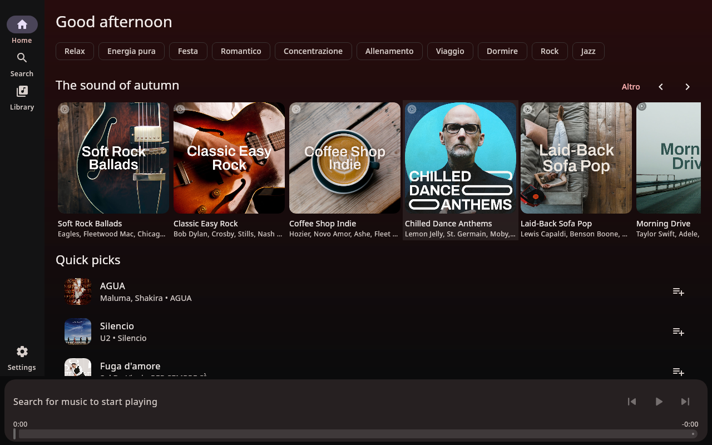
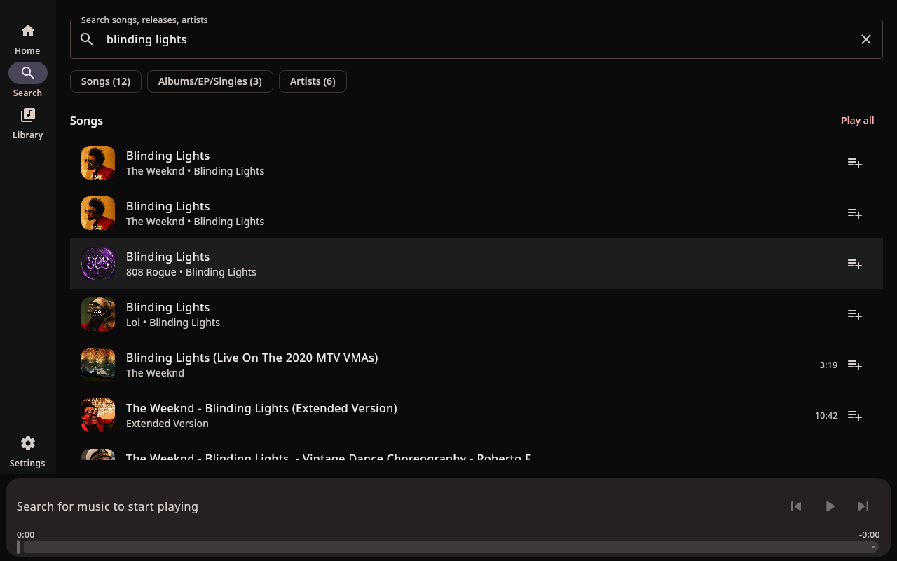
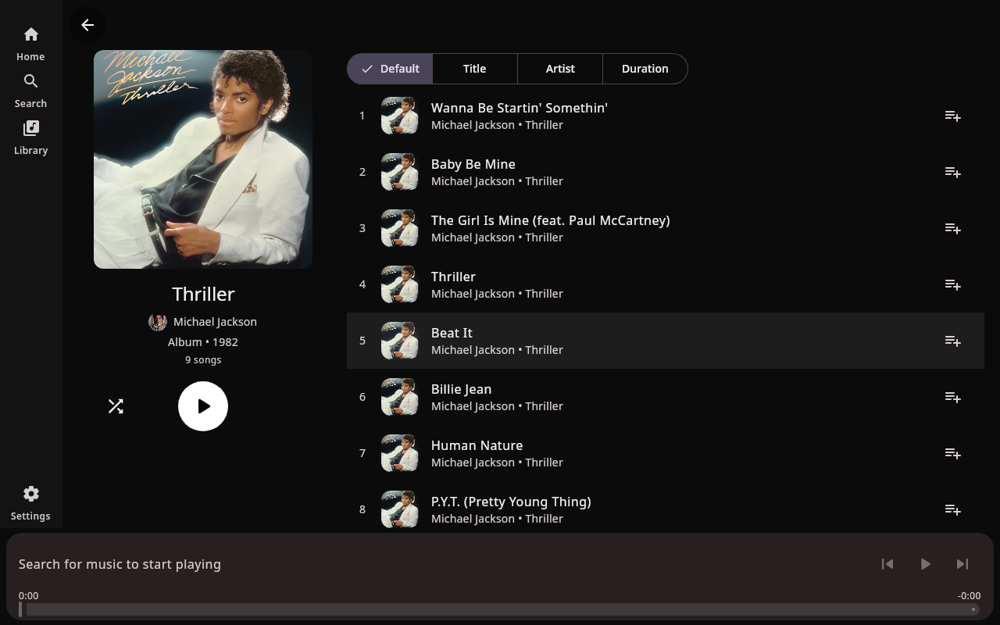

# NixieTube, native YouTube Music client (Kotlin + Compose Multiplatform)

A Material 3 desktop client for YouTube Music. No browser, no web views:
it talks to YouTube Music's InnerTube API directly (search, browse, streams)
and plays audio through a reusable mpv subprocess. There is no web player
involved, so there are no video ads and nothing to block.





## Features

- Home feed, search (songs, releases, artists), album/artist/playlist pages,
  queue with shuffle and repeat, radio auto-continuation.
- Now playing view with queue, synced lyrics (click a line to seek), and a
  song info tab with likes, plays and release year.
- Library, liked songs, playlists, subscriptions and ratings via Google
  sign-in (Desktop-type OAuth browser flow) or a browser cookie fallback.
- Listening history sync: played tracks are reported so your YouTube Music
  history and recaps stay up to date.
- Last.fm scrobbling with now-playing updates (needs your own API key from
  last.fm/api, set in Settings).
- Desktop integration: MPRIS service (`org.mpris.MediaPlayer2.nixietube`)
  for media keys and playerctl, plus Discord Rich Presence over local IPC.
- Artwork cache (Ktor + ImageIO, no image library).

## Why a native client

The website plus an ad blocker is a fine setup, and this app does not try
to replace it. NixieTube is for listeners who want their music in a real
desktop app instead of a browser tab: global media keys and playerctl
support through MPRIS, Discord Rich Presence, Last.fm scrobbles, synced
lyrics you can click to seek, and a fraction of the memory footprint, all
without keeping a browser open.

## Modules

All business logic lives in UI-free `core` modules on purpose: only
`:desktop` contains Compose code, so the UI layer can be swapped later
(e.g. Qt/QML) without rewriting the app.

- `:core:innertube`, InnerTube client (Ktor): home shelves, search with
  typed sections (songs/albums/artists/playlists), album/artist/playlist
  details, up-next/radio continuation, header-based auth. Stream URLs are
  resolved with NewPipeExtractor (handles YouTube's throttling-parameter
  deciphering). LRCLIB lyrics live in the desktop module.
- `:core:player`, `PlayerEngine` interface + mpv subprocess backend,
  `PlayerController` (queue, shuffle/repeat, radio auto-continuation,
  500 ms position ticker) over `StateFlow`. No UI imports.
- `:core:artwork`, artwork cache (Ktor + ImageIO, no image library).
- `:desktop`, Compose Multiplatform M3 UI (home, search, detail,
  library/account, player bar, now-playing with queue + synced lyrics),
  MPRIS service (`org.mpris.MediaPlayer2.nixietube`), Discord Rich
  Presence over local IPC, Last.fm scrobbling.

## Requirements

- JDK 21+ to build and run (tested on 26)
- mpv installed (required audio backend)
- A display (X11/Wayland) for `:desktop:run`
- Gradle wrapper (`./gradlew`), no system Gradle needed
- For account features: a Google Cloud OAuth client of type
  **Desktop app** with YouTube Data API v3 enabled
- For Last.fm: an API key and shared secret from last.fm/api

## Run

```sh
./gradlew :desktop:run
./gradlew :desktop:runTrimmed   # same app on a 50 MB jlink-trimmed runtime
```

```sh
./gradlew :core:innertube:smoke    # home, search, stream resolve, album detail
```

## How auth works

Two mechanisms, split by what actually accepts them:

- **Playback, search, browse**: anonymous InnerTube. No login needed.
- **Library, playlists, liked songs, ratings**: YouTube Data API v3 with
  an OAuth token (browser flow: approve in the browser on this machine via
  a loopback redirect, PKCE + secret, offline access so a refresh token is
  issued; tokens persist with auto-refresh). InnerTube
  rejects third-party OAuth/cookie sessions from here, so account data
  deliberately bypasses it.
- **Cookie login** (paste the `Cookie` header in Settings) is kept as a
  fallback: paste via DevTools' *view source*, as the pretty headers view
  truncates long values.
- **Last.fm**: create an application at last.fm/api, paste the key and
  secret in Settings, connect, and approve in the browser. Scrobbles follow
  the standard rule (tracks over 30 seconds, half played or 4 minutes).

## Configuration

`~/.config/nixietube/`:

- `auth.properties`, `cookie` + `sapisidHash` (copied from an
  authenticated `youtubei/v1/*` browser request) unlocks library/likes.
  Manageable from the Settings screen.
- `config.properties`, `discord.appId` (optional), `discord.enabled`,
  `discord.statusText` (`app`, `song`, or `artists`), `mpris.enabled`,
  `lastfm.*` credentials and toggle. Discord needs a Discord application ID
  (https://discord.com/developers/applications) and a running client.
  `discord.appId` is optional, when empty, the built-in application ID
  (1552404006498869318) is used automatically.

## Notes / known limits

- Audio-only v1, anonymous-first; account features go through the Data
  API (OAuth device flow) since InnerTube rejects third-party sessions.
- Windows/macOS packaging deferred; code is multiplatform-clean.
- InnerTube is unofficial and can break when YouTube changes it,
  same maintenance treadmill as other unofficial clients.
